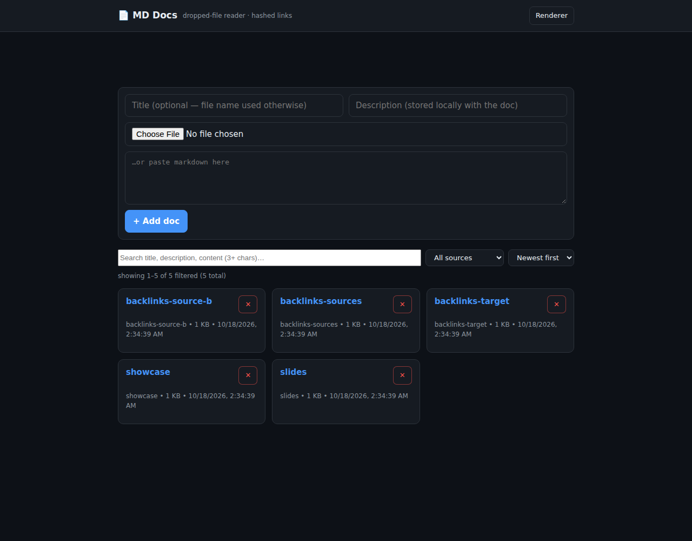
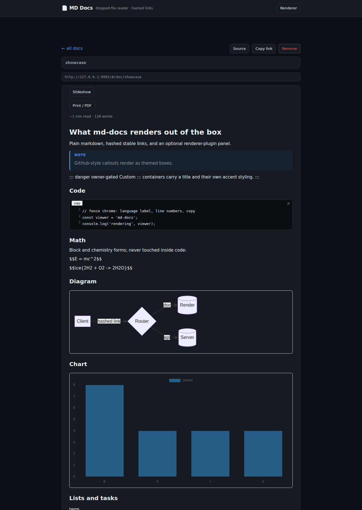
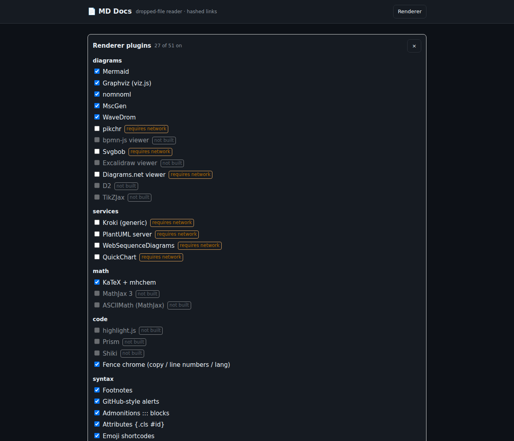
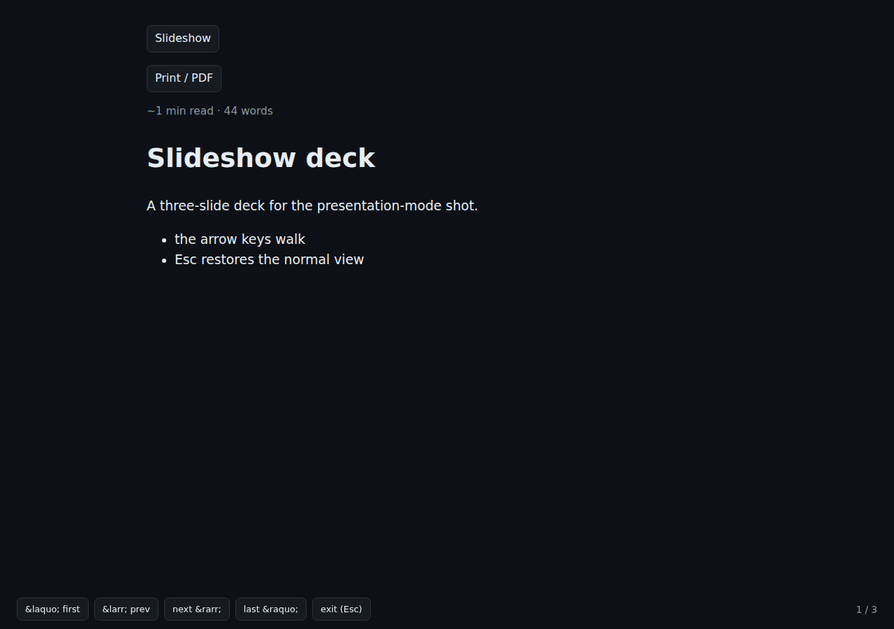
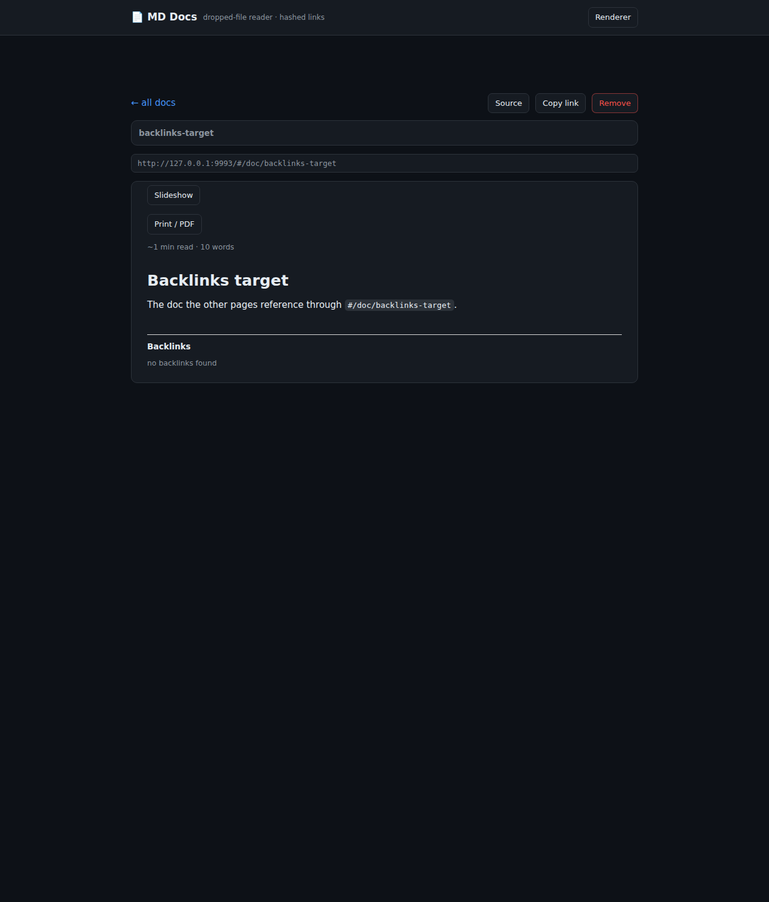
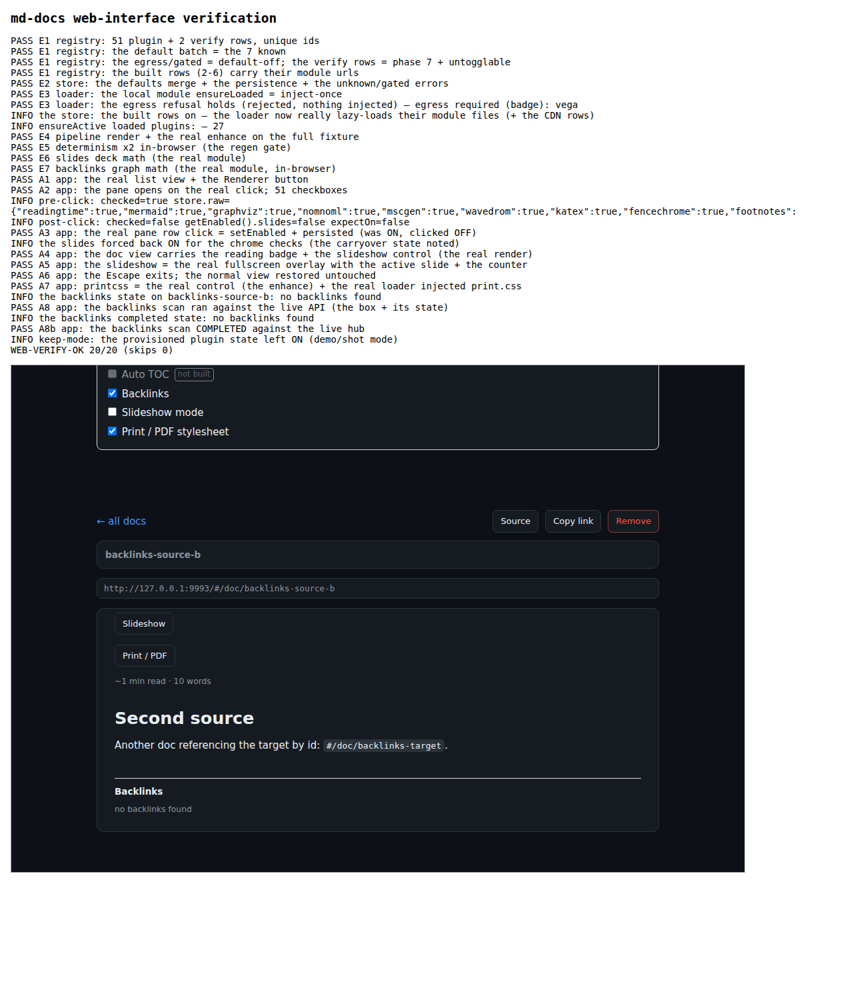

# md-docs — a zero-dependency markdown doc viewer

A browsable, searchable markdown library with a full **renderer plugin panel** —
and the whole thing is stdlib-only Node: no npm install, no build step, no
framework. Point it at a directory of `.md` files and it gives every document a
stable hashed link, a rendered view, and an optional plugin stack everything
from Mermaid diagrams to a slideshow mode. It also drops into an existing
dashboard's nginx TLS front as its `/docs/` page.

## What it looks like

All screenshots are the real rendered output of this tree, shot on a scratch
loopback instance.

| Library (paginated, searchable, sortable) | A rendered doc — code chrome, math, Mermaid, charts, callouts, footnotes, tasks |
|---|---|
|  |  |

| The Renderer pane — 51 rows, 10 categories, egress + gated badges | Slideshow mode — `---` separators become a fullscreen deck |
|---|---|
|  |  |

| Backlinks — the doc-id mention graph from the live API | The self-testing web-verify page |
|---|---|
|  |  |

## Highlights

- **Zero dependencies.** The server, the CLI, the test runner, the renderer
  panel, and the browser verification harness are all stdlib Node or vanilla
  browser JS. `marked` is vendored; heavy plugin libraries lazy-load from CDN
  only when you enable their rows.
- **Hashed links.** Every doc has a stable `#/doc/<id>` URL that survives
  re-adds; anchors are deep-linkable (`#/doc/<id>/<slug>`).
- **Search that actually searches.** Title/description instantly; full-text
  content search over the whole library from 3+ characters, via a throttled
  background deep-scan.
- **The renderer panel.** 53-option census, 28 shipped modules, 51 toggleable
  rows grouped by category with a count badge. Your choices persist in
  `localStorage`; unset keys fall back to the registry defaults.
- **Egress discipline.** Rows that would send document text to a remote
  service (kroki, hosted embeds) carry a "requires network" badge and stay
  disabled until a per-row confirm; the badge stays visible while on.
  Local-only rows (including the backlinks scanner) are ordinary checkboxes.
- **Presentation mode.** `---` separators split any doc into a fullscreen
  deck: arrows/Space walk, Home/End jump, Esc exits — the normal view is
  never mutated.
- **Self-verifying.** The panel ships with a zero-dep browser harness and a
  machine-generated verification report; see below.

## Quick start (standalone)

```
git clone https://github.com/dmrobbi/md-docs md-docs
cd md-docs
node server.js                 # http://127.0.0.1:9992/ — md-docs.conf next to it
node add.js file.md "Title" "Some description"
```

Then open the URL, hit `Renderer`, and turn on the diagram/math/chart families.

## Deploy as the dashboard's /docs page

Requirements: a dashboard host with node, and an nginx TLS site you want
`/docs/` served under.

```
git clone https://github.com/dmrobbi/md-docs /opt/md-docs
sudo SOC_USER=<install-user> bash /opt/md-docs/deploy/install.sh
```

The installer: copies the tree, writes a loopback-bound conf, installs and
enables the system unit, inserts the marker-anchored `/docs/` location into
the dashboard's nginx site, reloads nginx, seeds two sample docs if the
library is empty, then verifies. Manual equivalent: render the unit template
and drop `deploy/nginx-docs-location.conf` into the dashboard site.

The same tool also installs as a **user-level unit** for personal/lab use
(see `deploy/` and the auth section for the token-gated shape).

## The library

- `#/` — paginated cards (20/page), sort by new/old/title/size, instant
  title+description search, content deep-scan at 3+ chars, add form (file or
  paste), per-card remove.
- `#/doc/<id>` — the rendered document, `Source` raw toggle, `Copy link`.
- Optional front-matter (`title:` / `description:`) is stripped and used by
  the metadata surface.

## The renderer plugin panel

One checkbox per plugin row; the families:

- **diagrams** — Mermaid (the flagship: flowcharts, sequences, class,
  state, ER, gantt, pie, gitgraph, mindmap, timeline, quadrant, xychart…),
  Graphviz (viz.js WASM), nomnoml, MscGen, WaveDrom.
- **math** — KaTeX `$$..$$` + `\(..\)`/`\[..\]` + mhchem `\ce{}`; the
  formulas inside code never render.
- **code** — fence chrome: per-fence copy (the RAW text, not html), line
  numbers, the language label.
- **syntax** — footnotes (with backrefs), GitHub-style alerts, `:::`
  admonitions, attributes (`{.cls #id k=v}`), emoji shortcodes, heading ids
  + hover copy-link, definition lists, YAML front-matter, figures
  (`<figure>`/`<figcaption>`), interactive tasklists (persisted per doc).
- **charts** — ```` ```chart ```` JSON blocks on a canvas (Chart.js), Vega
  via the kroki encode (egress-gated).
- **media** — asciinema `.cast` inline player (https-only), mp4/webm/mp3
  players, PDF links as native `<embed>` (dependency-free), image lightbox
  (glightbox).
- **maps** — Leaflet blocks, offline-tiles-first: NO external tiles by
  default, OSM = an explicit opt-in key.
- **experience** — reading time, backlinks (a doc-id mention graph built
  from the live API, throttled + cached), slideshow mode, the print/PDF
  view (page-break aware, chrome hidden, external hrefs expanded).

Unbuilt-but-planned rows stay visible greyed ("not built") so the panel
doubles as a roadmap. The pick list with the shipped flags:
`docs/PLUGINS-OPTIONS.md` — the as-built verification:
`docs/PHASES-VERIFICATION.md`.

Deep links: append `?renderer=1` to open the pane directly, or `?slides=1`
on a document URL to drop straight into deck mode.

## Configuration (`md-docs.conf`)

```ini
host = 127.0.0.1     # loopback = behind a fronting nginx; 0.0.0.0 = direct
port = 9992
docsDir = mds        # flat .md files; slugified basenames; .metadata.json sidecars
# token =            # when set: every /api/* requires a bearer/X-MD-Docs-Token
tls = false          # or true + tlsCert/tlsKey (an openssl self-signed auto-generates)
```

Precedence: env (`MD_DOCS_HOST`/`MD_DOCS_PORT`/`MD_DOCS_DIR`/`MD_DOCS_TOKEN`/
`MD_DOCS_TLS*`) > this file > the defaults. The conf path relocates via
`MD_DOCS_CONF` (a deployment's host-specific values can live in an untracked
`md-docs.local.conf`). Restart the unit after edits.

## API

- `GET /api/docs` — the list (id/title/description/bytes/mtime)
- `POST /api/docs` — add `{title, description, content}` → `{id}` (20 MB cap)
- `GET /api/doc/<id>` — raw markdown
- `DELETE /api/doc/<id>` — remove

`add.js` = the CLI wrapper for add.

## Auth (the optional bearer gate)

Set `MD_DOCS_TOKEN` (env/EnvironmentFile) or the conf's `token` → every
`/api/*` requires `Authorization: Bearer` or `X-MD-Docs-Token`
(timing-safe, fail-closed). The static UI stays open; it prompts once,
stashes the token in `localStorage`, and attaches it to every call.
Recommended on a shared host: the token only in a `0600` env file + unit
restart; rotate by editing + restarting.

## Verification

The panel verifies itself:

```
/snap- or system- chromium --headless=new --no-sandbox --disable-gpu \
  --user-data-dir=<a throwaway dir> --virtual-time-budget=55000 \
  --dump-dom 'http://<your-host>:<port>/verify.html' 2>/dev/null \
  | grep -E 'PASS|FAIL|WEB-VERIFY'
```

Pass = the final marker `WEB-VERIFY-OK n/m`. The harness = engine-level
checks (the real registry/store/loader/pipeline over a full trigger
fixture, determinism x2) + app-level checks (driving the real app in a
same-origin iframe: the pane clicks, row flips, the slideshow's real
Escape, printcss, the backlinks scan completing). Read-only; the settings
are saved/restored. The manual click-through battery + commands:
`docs/WEB-VERIFY.md`. The machine-verified phase report:
`docs/PHASES-VERIFICATION.md`.

## Layout

| File | Role |
|---|---|
| `server.js` | the backend: static UI + JSON API + the optional token gate |
| `md-docs.conf` | the app settings (relocatable; env > conf > defaults) |
| `public/` | the UI: marked (vendored), the app, the plugin registry/loader/pipeline, the modules, the verify harness |
| `docs/PLUGINS-OPTIONS.md` | the 53-option census with per-row shipped flags |
| `docs/PHASES-VERIFICATION.md` | the machine census of the build + the browser-battery results |
| `docs/WEB-VERIFY.md` | the real-interface verification: commands + the manual battery |
| `deploy/` | the unit/nginx templates + the idempotent installer |
| `add.js` | the CLI add helper |
| `mds/` | the runtime doc storage (NOT committed) |

## License

MIT — see [LICENSE](LICENSE).