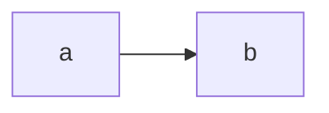

# WEB-VERIFY — real web-interface verification for the md-docs panel

How to REALLY drive the deployed md-docs instances (list/router/pane/lazy
loads/re-renders/slideshow/print/backlinks) and prove behavior, not just file
presence. Two complementary surfaces:

- **The automated harness** — `public/verify.html` + `verify.js`: a zero-dep
  self-testing page served by both deployments. It loads the REAL vendor
  marked + registry + loader + pipeline, renders a full trigger fixture
  through the same `renderMd` path the app uses, then drives the REAL app
  inside a same-origin iframe: the actual Renderer button click, the pane's
  51 checkbox rows, a real pane-row flip (setEnabled + persist), the doc
  router, the slideshow overlay open + a real Escape keydown, printcss
  (control + injected sheet), and the backlinks scan against the live API.
  Read-only against the hub (no docs added/deleted); every settings toggle
  is saved first + restored after.
- **The manual click-through battery** — below; the human/agent path for the
  interactive surfaces (clipboard, print-preview, persistence-on-reload,
  CDN visuals, egress confirm) the automated page deliberately cannot or
  should not fully simulate.

## Automated harness — headless commands

thing1 (the dashboard-front TLS, self-signed → ignore-cert; the snap
chromium = keep the profile inside its own common area — the `~/.cache`
profile dirs are snap-shadowed and unreliable):

```
/snap/bin/chromium --headless=new --no-sandbox --disable-gpu --ignore-certificate-errors \
  --user-data-dir=/home/wez/snap/chromium/common/mdocs-verify-a --virtual-time-budget=55000 \
  --dump-dom 'https://192.168.1.106:4771/docs/verify.html' 2>/dev/null \
  | grep -E 'PASS|FAIL|SKIP|WEB-VERIFY|INFO|HARNESS'
rm -rf /home/wez/snap/chromium/common/mdocs-verify-a
```

trooper2 (plain HTTP, the app's own :9991):

```
/snap/bin/chromium --headless=new --no-sandbox --disable-gpu \
  --user-data-dir=/home/wez/snap/chromium/common/mdocs-verify-b --virtual-time-budget=55000 \
  --dump-dom 'http://10.0.0.66:9991/verify.html' 2>/dev/null \
  | grep -E 'PASS|FAIL|SKIP|WEB-VERIFY|INFO|HARNESS'
rm -rf /home/wez/snap/chromium/common/mdocs-verify-b
```

Note: `--dump-dom` = the page's final DOM — the results `<pre>` = inside the
dump; the grep = the extraction. The harness read-only + the state save/restore
= safe to run repeatedly.

Pass condition: the last marker = `WEB-VERIFY-OK n/m (skips k)` with m = n +
0 fails. Any `FAIL`/`HARNESS-TIMEOUT` = red. `SKIP` = an honest not-proven
(with the reason), never counted as a pass.

What the harness proves (2026-10-18 shape, 20/20):

- E1 the registry contract: 51 plugin + 2 verify rows, unique ids, the
  seven-default batch, egress/gated default-off, verify = untogglable, and
  every built row carries its own module file (the live-wiring regression
  gate).
- E2 the settings store: the defaults merge, the real localStorage write,
  unknown-id + gated/egress errors.
- E3 the loader: a local module = inject-once across repeated loads; the
  egress refusal holds until a confirm (the rejection awaited, nothing
  injected).
- E4 the pipeline+enhance on the FULL fixture: fence chrome, GitHub alert,
  footnotes, heading ids, reading badge, the ::: admonition (the supported
  blank-line form), definition lists, tasklist checkboxes, the
  chart/mermaid/map boxes, figures, emoji, the print control + the injected
  print.css, the slides control — the REAL lazy loads (27 rows) backing them.
- E5 the determinism x2 (the regen gate) in the real browser.
- E6/E7 the slides deck math + the backlinks graph math via the real modules.
- A1-A8b the app level: the real list → the real pane click (51 checkboxes)
  → a real pane-row flip persisted → the doc view via the real router (the
  reading badge + the slideshow control) → the slideshow overlay with the
  active slide + counter → the Escape exit restoring the view → the
  printcss control + sheet → the backlinks scan COMPLETING against the live
  hub (the list / the honest no-backlinks line).

## Manual click-through battery

Work on thing1 (`https://192.168.1.106:4771/docs/`; trooper2 mirrors) unless
noted. For the content-trigger items create a scratch doc with the `+ Add
doc` form (the real API write path) and REMOVE it from its own card when
done (`Remove` — the real DELETE path). Suggested scratch content:

````
---
title: browser battery scratch
---
# Scratch {#scr}

> [!WARNING]
> the alert case

::: danger custom
the admonition case
:::

term
: definition

:sparkles: :tada:
  ← the figure/figcaption
- [ ] tasklist one
- [x] tasklist two
$$\ce{2H2 + O2 -> 2H2O}$$



```chart
{"type":"line","data":{"labels":["x","y"],"datasets":[{"data":[1,3]}]}}
```

---

slide two after hr

[^s]: scratch footnote
````

Phase-by-phase:

1. **Pane (P0/P1)** — Renderer opens/closes; the rows = grouped by category;
   the badge = "N of 51 on"; the gated rows = greyed "not built"; the
   egress rows = the "requires network" badge + disabled until the toggle's
   confirm dialog is accepted. Reload = the state returns.
2. **Defaults (P2)** — in a doc: the alert = the colored callout; a fence =
   the language label + line numbers + the copy (clicking copies the RAW
   text — paste it to check the un-escaped form); `[^ref]` → the footnote
   section + the backrefs; the heading hover → copy-link; the reading
   badge top-of-doc; math: block `$$..$$` + chemical `\ce{}` — math inside
   fences/code NEVER rendered.
3. **Diagrams (P3)** — the mermaid fence = the real diagram (the CDN, lazy);
   a malformed fence keeps the source visible; nomnoml/mscgen/wavedrom
   same-shape; graphviz `dot`. Dark themes: the mermaid syncs.
4. **Syntax/media (P4)** — the ::: containers; the attributes `{#id .cls}`;
   the emoji shortcodes (the unknown = literal); def lists; the
   front-matter stripped from a doc with meta; the figure/figcaption; the
   tasklist checkbox toggle → RELOAD → the state persisted (per doc id);
   mp4/mp3 links → the native players; an image grid = the lightbox
   (click-to-zoom, the CDN); a `.pdf` link = the in-page embed.
5. **Charts/maps (P5)** — ```chart = the canvas chart + the source
   fallback on a malformed config; the vega fence = the kroki egress row
   (confirm first — the badge stays visible); the leaflet = the map with
   NO external tiles by default; an explicit `"tiles":"osm"` config = the
   OSM edge.
6. **Experience (P6)** — the backlinks: a doc referencing another via a
   `#/doc/…` link → the list under the article; an unlinked doc → "no
   backlinks found"; the scan = throttled + cached. The Slideshow control
   → the fullscreen deck: ArrowRight/Space/n = next; ArrowLeft/p = prev;
   Home/End = the ends; Esc = exit (the normal view untouched); the
   `---` separators = the slide boundaries. Print/PDF: the control or
   ctrl+P → the preview: no chrome/topbar/search/copy-row; the headings
   keep their blocks; the fences wrap; the external links print their
   hrefs; the math/diagram render in-print (colors kept).

Egress discipline: NOTHING external loads for the egress rows without the
explicit per-row confirm; the confirm badge = visible while on.

## Known shape notes

- The ::: admonition form = the blank-line-separated body (the tight form
  pairs nothing — the module's documented shape).
- The fixtures' images = intentionally unreachable — the figure markup is
  the assertion, not the picture.
- The vega/pikchr = the kroki-routed rows = egress-gated (the badge + the
  confirm) — the pikchr = no module (the documented decision).
- The harness never sets confirmEgress: the CDN loads it needs = the
  non-egress rows only (the diagram/chart libraries are the same-host
  origins' vendor pulls? — no: they are jsdelivr pulls; they are NOT
  egress-classified because the DOC TEXT never leaves).